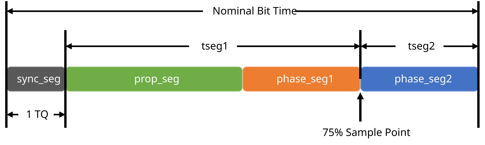
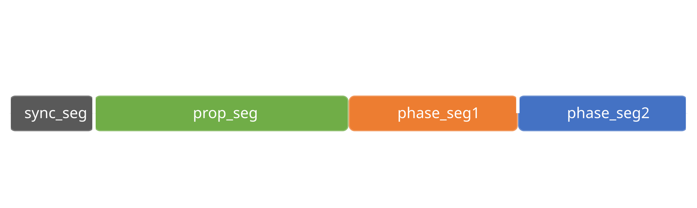

Bit Timing Configuration
========================

The CAN protocol, specified in ISO 11898, allows the bitrate, sample point
and number of samples to be optimized for a given application. These
parameters, known as bit timings, can be adjusted to meet the requirements
of the communication system and the physical communication channel.

These parameters include:

* **tseg1**: The time segment 1 (TSEG1) is the amount of time from the end
  of the sync segment until the sample point. It is expressed in time quanta (TQ).
  TSEG1 is the sum of the propagation segment, which compensates for the signal
  delays on the bus and in the transceivers, and the phase buffer segment 1.
* **tseg2**: The time segment 2 (TSEG2) is the amount of time from the
  sample point until the end of the bit. It is expressed in TQ.
  TSEG2 is also known as phase buffer segment 2.
* **sjw**: The synchronization jump width (SJW) is the maximum number
  of TQ by which the controller can lengthen phase buffer segment 1 or
  shorten phase buffer segment 2 to resynchronize. It must not be larger
  than either phase buffer segment.
* **sample point**: The sample point is defined as the point in time
  within a bit where the bus controller samples the bus for dominant or
  recessive levels. It is typically expressed as a percentage of the bit time.
  The sample point depends on the bus length and propagation time as well
  as the information processing time of the nodes.

   Bit Timing and Sample Point

For example, consider a bit with a total duration of 8 TQ and a sample
point at 75%. The values for TSEG1, TSEG2 and SJW would be 5, 2, and 2,
respectively. The sample point would be 6 TQ after the start of the bit,
leaving 2 TQ for the information processing by the bus nodes.

.. note::
   The CAN standard does not restrict the position of the sample point.
   However, a sample point below 50% leaves only a short phase buffer
   segment 1 and therefore a small SJW, which reduces the tolerable deviation
   of the oscillators. The sample point calculations of python-can and the
   strict mode therefore require a sample point of at least 50%. Sample points
   between 75% and 87.5% are common in practice.

.. note::
   In CAN FD, the arbitration (nominal) phase and the data phase can have
   different bit rates. As a result, there are two separate sample points
   to consider.

.. note::
   At high data bit rates, CAN FD controllers rely on transmitter delay
   compensation. This mechanism can only be used with a data phase
   prescaler (``data_brp``) of 1 or 2.

Another important parameter is **f_clock**: The CAN system clock frequency
in Hz. The bit rate prescaler **brp** divides this frequency to derive the
TQ size. The relationship is ``f_clock = (tseg1+tseg2+1) * bitrate * brp``.
Since a bit consists of an integer number of TQ, brp, tseg1 and tseg2 have
to be chosen such that this relationship holds for the desired bit rate.
Typical CAN clock frequencies are 8-80 MHz.

In most cases, the recommended settings for a predefined set of common
bit rates will work just fine. In some cases, however, it may be necessary
to specify custom bit timings. The :class:`~can.BitTiming` and
:class:`~can.BitTimingFd` classes can be used for this purpose to specify
bit timings in a relatively interface agnostic manner.

:class:`~can.BitTiming` or :class:`~can.BitTimingFd` can also help you to
produce an overview of possible bit timings for your desired bit rate:

    >>> import contextlib
    >>> import can
    ...
    >>> timings = set()
    >>> for sample_point in range(50, 100):
    ...     with contextlib.suppress(ValueError):
    ...         timings.add(
    ...             can.BitTiming.from_sample_point(
    ...                 f_clock=8_000_000,
    ...                 bitrate=250_000,
    ...                 sample_point=sample_point,
    ...             )
    ...         )
    ...
    >>> for timing in sorted(timings, key=lambda x: x.sample_point):
    ...     print(timing)
    BR: 250_000 bit/s, SP: 50.00%, BRP: 2, TSEG1: 7, TSEG2: 8, SJW: 4, BTR: C176h, CLK: 8MHz
    BR: 250_000 bit/s, SP: 56.25%, BRP: 2, TSEG1: 8, TSEG2: 7, SJW: 4, BTR: C167h, CLK: 8MHz
    BR: 250_000 bit/s, SP: 62.50%, BRP: 2, TSEG1: 9, TSEG2: 6, SJW: 4, BTR: C158h, CLK: 8MHz
    BR: 250_000 bit/s, SP: 68.75%, BRP: 2, TSEG1: 10, TSEG2: 5, SJW: 4, BTR: C149h, CLK: 8MHz
    BR: 250_000 bit/s, SP: 75.00%, BRP: 2, TSEG1: 11, TSEG2: 4, SJW: 4, BTR: C13Ah, CLK: 8MHz
    BR: 250_000 bit/s, SP: 81.25%, BRP: 2, TSEG1: 12, TSEG2: 3, SJW: 3, BTR: 812Bh, CLK: 8MHz
    BR: 250_000 bit/s, SP: 87.50%, BRP: 2, TSEG1: 13, TSEG2: 2, SJW: 2, BTR: 411Ch, CLK: 8MHz

Strict Mode
-----------

Without strict mode, :class:`~can.BitTiming` and :class:`~can.BitTimingFd`
only check structural requirements: all prescalers and segments must be at
least 1 and SJW must not be larger than TSEG1 or TSEG2. Many CAN controllers
support much larger ranges than shown below.

Passing ``strict=True`` restricts the bit timings to the minimum configuration
ranges, which every CAN controller compliant with ISO 11898-1 has to support.
This can be used to ensure compatibility across a wide variety of CAN hardware.
In strict mode, the sample point must also be at least 50%. The timings returned
by ``from_sample_point()`` and ``iterate_from_sample_point()`` always satisfy
strict mode.

The strict ranges for CAN 2.0 (:class:`~can.BitTiming`) are:

* **brp**: 1 to 32
* **nominal bit time**: 8 to 25 TQ
* **tseg1**: 2 to 16 TQ
* **tseg2**: 2 to 8 TQ
* **sjw**: 1 to 4 TQ and less than tseg1, because tseg1 contains at least
  one TQ of propagation segment
* **bitrate**: 5 kbit/s to 1 Mbit/s

The strict ranges for CAN FD (:class:`~can.BitTimingFd`) are:

* **nom_brp** and **data_brp**: 1 to 32
* **nominal bit time**: 8 to 80 TQ
* **data bit time**: 5 to 25 TQ
* **nom_tseg1**: 2 to 128 TQ with a shared prescaler, 2 to 64 TQ with
  separate prescalers
* **nom_tseg2**: 2 to 32 TQ with a shared prescaler, 2 to 16 TQ with
  separate prescalers
* **nom_sjw**: 1 to 32 TQ with a shared prescaler, 1 to 16 TQ with
  separate prescalers, and less than nom_tseg1
* **data_tseg1**: 1 to 16 TQ, since the data phase may have no propagation
  segment
* **data_tseg2**: 2 to 8 TQ
* **data_sjw**: 1 to 8 TQ

Configuration
-------------

It is possible to specify CAN 2.0 bit timings
using the config file:

.. code-block:: none

    [default]
    f_clock=8000000
    brp=1
    tseg1=5
    tseg2=2
    sjw=1
    nof_samples=1

The same is possible for CAN FD:

.. code-block:: none

    [default]
    f_clock=80000000
    nom_brp=1
    nom_tseg1=119
    nom_tseg2=40
    nom_sjw=40
    data_brp=1
    data_tseg1=29
    data_tseg2=10
    data_sjw=10

A :class:`dict` of the relevant config parameters can be easily obtained by calling
``dict(timing)`` or ``{**timing}`` where ``timing`` is the :class:`~can.BitTiming` or
:class:`~can.BitTimingFd` instance.

Check :doc:`configuration` for more information about saving and loading configurations.

Reference
---------

.. autoclass:: can.BitTiming
    :class-doc-from: both
    :show-inheritance:
    :members:
    :member-order: bysource

.. autoclass:: can.BitTimingFd
    :class-doc-from: both
    :show-inheritance:
    :members:
    :member-order: bysource
